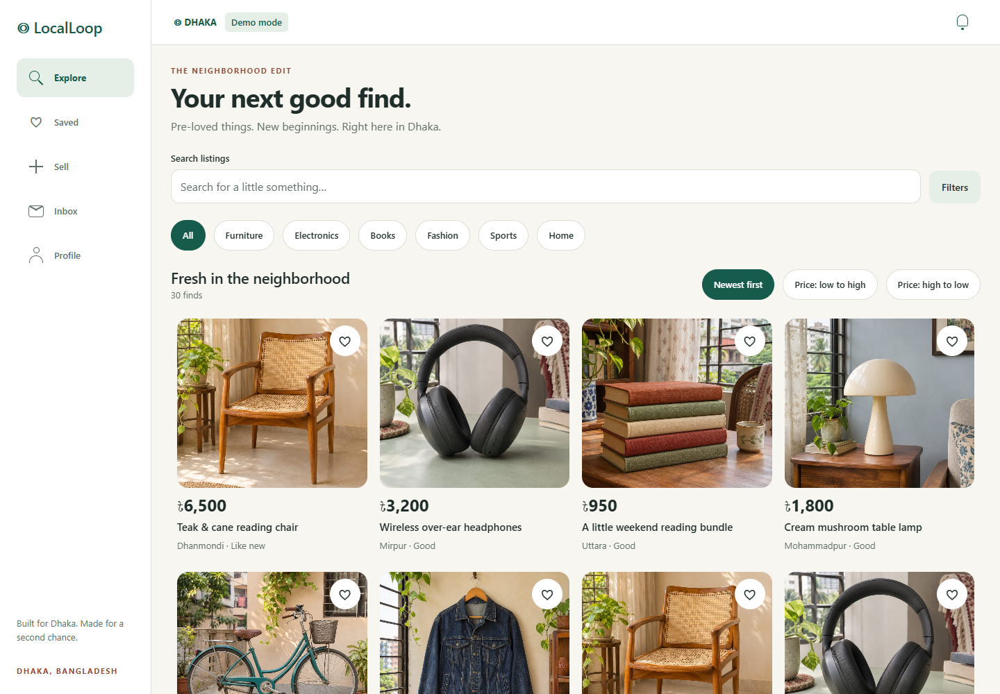
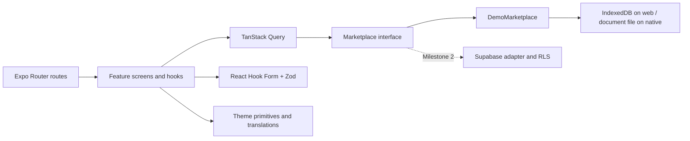

# LocalLoop

A neighborhood marketplace for Dhaka: **good finds, close by**. Prices are in BDT, with English and Bangla interfaces and light/dark themes.

Milestone 1 implements the visitor-local demo. No Supabase project, environment variables, signup, or API key is needed. Live authentication, shared listings, and real messaging belong to later milestones.

<!--  -->

## App showcase

Mobile views in dark mode, from browsing nearby finds to publishing a listing in the local demo.

| Explore nearby listings                                                                                                                         | View item details                                                                                                                                       | Create a listing                                                                                                                                |
| ----------------------------------------------------------------------------------------------------------------------------------------------- | ------------------------------------------------------------------------------------------------------------------------------------------------------- | ----------------------------------------------------------------------------------------------------------------------------------------------- |
|  |  |  |

| Add photos                                                                                                                                   | Set price and neighborhood                                                                                                                           | Published local listing                                                                                                                            |
| -------------------------------------------------------------------------------------------------------------------------------------------- | ---------------------------------------------------------------------------------------------------------------------------------------------------- | -------------------------------------------------------------------------------------------------------------------------------------------------- |
|  |  |  |

## Run it

Use Node.js 24 LTS and npm:

```sh
npm ci
npm run web
```

On Windows PowerShell with script execution restricted, use `npm.cmd` and `npx.cmd` instead of changing your execution policy.

For the production SPA preview:

```sh
npm run export:web
npm run preview
```

Open http://127.0.0.1:4173 and choose **Explore demo**. The preview server supplies the same deep-link fallback expected on Vercel. This is a local preview, not a public deployment.

## Try it in a minute

1. Enter **Explore demo** and filter to Furniture.
2. Save the reading chair, open Saved, then open its details.
3. Select Message seller and send a message. The reply is explicitly **Simulated**.
4. If you have another minute, open Sell, fill a listing, choose a bundled demo photo, and publish locally.

Refresh to verify persistence. Use Profile → Reset demo to start fresh. Reset clears demo listings, uploaded photo blobs, saves, drafts, chats, and notifications; theme and language remain.

Demo personas and listings are fictional. No real seller is contacted, no payment is processed, and locally created listings are available only on the current device/browser origin. Fixture links can be shared with other visitors. Demo content never becomes live content.

## Architecture



- `app/` contains thin route wrappers and the welcome screen.
- `src/features/` groups discovery, listings, selling, messaging, profile, and notifications.
- `src/data/types.ts` defines the shared data contract. Only the demo adapter is implemented in this milestone. Auth will be a separate live capability, not a fabricated demo session.
- `src/data/demo.ts` serializes mutations, persists before confirming them, and keeps message IDs stable across retries. It implements domain checks, not production security.
- Query keys include mode and identity. TanStack Query handles fetched data, cursor pagination, and optimistic saves. Failed saves roll back only their own item, preserving concurrent changes to other items.
- Zustand holds theme and language only. Forms and persistent drafts have their own owners.
- Web snapshots and compressed photo blobs use IndexedDB. Native demo snapshots use Expo FileSystem. Photo URLs are temporary views of durable blobs and are revoked when their component unmounts.
- Replies are deterministic and labeled. An active chat suppresses its notification; replies received elsewhere increase unread counts. Profile contains clearly labeled failure simulation controls.

See [the design plan](docs/plan.md), [domain glossary](CONTEXT.md), and [architecture decisions](docs/adr/).

## Important choices

Expo SDK 57 is pinned with React 19.2.3 and React Native 0.86.3, matching its bundled compatibility manifest. Dependencies were installed from existing local package archives because outbound package access was unavailable in the development environment. The lockfile uses public npm URLs and integrity hashes; the temporary cache reader is not required to run this project.

The UI uses React Native primitives on all platforms, with platform-specific persistence and photo handling. No browser-only replacement application or Expo server routes are used. The web output is an Expo Router single-page app; this sacrifices per-listing server-rendered SEO and social preview metadata.

Motion is intentionally minimal: route transitions, image fades, and programmatic chat scrolling are unanimated. Buttons have at least 44-point targets, text scales by default, controls have accessible names, and the feed has keyboard-operable actions. A full native screen-reader audit remains in milestone 4.

## Verification

```sh
npm run typecheck
npm run lint
npm test
npm run export:web
npx playwright install chromium
npm run test:smoke
```

The test runner accepts `PLAYWRIGHT_CHROMIUM_EXECUTABLE` if you need to use an existing Chromium installation. CI runs these checks, but a hosted CI run has not been performed in this workspace.

See [Milestone 1 verification](docs/milestone-1.md) for actual results, manual checks, and unresolved platform limits. Unit tests cover validation, pagination, draft restoration, mutation failures, local ownership checks, optimistic rollback, stable message retries, unread behavior, and reset races. These are **not Supabase RLS tests**; those arrive with the database.

## Feature matrix

| Capability                                   | Current implementation                                                            | Live/native status                                                          |
| -------------------------------------------- | --------------------------------------------------------------------------------- | --------------------------------------------------------------------------- |
| Welcome, five destinations, responsive grid  | Working local demo                                                                | Android/iOS runtime unverified                                              |
| Search, filters, sorting, pagination, detail | Local dataset, English and Bangla                                                 | Remote adapter planned                                                      |
| Save/unsave and rollback                     | Persistent local mutation                                                         | Supabase writes planned                                                     |
| Sell, edit, mark sold, delete                | Visitor-owned local listings                                                      | Shared ownership/RLS planned                                                |
| Draft restore                                | IndexedDB on web; native file implementation                                      | Native restart unverified                                                   |
| Photos                                       | Bundled photos; browser picker, compression and blob persistence                  | Native gallery/camera and upload progress/retry planned in milestone 2      |
| Chat and unread counts                       | Simulated replies, paginated history, pending/sent/failed, duplicate-safe retries | Supabase realtime planned in milestone 3                                    |
| Notification center                          | Simulated events, unread indicator                                                | Server events and optional native push planned                              |
| Profile and avatar                           | Local editable profile; browser avatar picker                                     | Auth and session lifecycle planned in milestone 2                           |
| Theme/language                               | Persisted preferences, bilingual fixtures and UI                                  | Device font/screen-reader review pending                                    |
| Offline                                      | Already-open web demo can read/write locally; drafts persist                      | Cold-start web offline loading and live cache policy planned in milestone 4 |
| Location                                     | Manual neighborhood selection; no coordinates stored                              | Optional location suggestion planned                                        |
| Sharing                                      | Fixture deep links, clipboard/native share path                                   | Native link handlers unverified; local creations are not transferable       |
| Backend and security                         | No backend in this milestone                                                      | Migrations, seeds, RLS, storage policies and auth planned                   |
| Deployment                                   | Vercel configuration included                                                     | No public deployment performed                                              |

<!--
## Known limits

- Native gallery/camera, haptics, location, push, and live offline caching are not implemented yet. Use bundled photos to exercise the native demo flow once device testing is available. A native development build and platform-specific permission configuration will be needed for the later native integrations; browser tests do not establish native support.
- The browser has no service worker yet. An already-loaded demo works offline; a first visit or cold offline reload is not guaranteed.
- Demo snapshots are designed for a single active tab. Concurrent edits from multiple tabs are not synchronized. Native file writes are not crash-atomic; device resilience testing is still required.
- Autosave is debounced by 400 ms. Wait for the saved indicator before forcibly closing the tab. Browser storage can be evicted or disabled; failures are surfaced rather than treated as successful writes.
- Six generated photos are reused across 30 sample listings. The personas, listings, and messages are fictional. See [asset provenance](assets/README.md).
- There is no moderation, public trading, account deletion workflow, or production data-retention policy. Live mode will start as an approved-account portfolio sandbox.

## Configuration and deployment

Milestone 1 requires no `.env` file. `.env.example` contains placeholder public Supabase settings for the next milestone. An `EXPO_PUBLIC_*` variable is bundled into client code and is not secret. Service-role keys, database passwords, and server-only credentials must never be included in the client or a public environment variable. RLS must enforce live access even when a caller bypasses the UI.

For Vercel, import this repository, select Node 24, and use the included `vercel.json`: `npm run export:web`, output `dist`, with SPA deep-link fallback. Verify a direct `/listing/fixture-1?mode=demo` visit after deployment. Native app links require later platform association/build configuration. No deployment account was used in this milestone.

## Portfolio material

- [60–90 second walkthrough](docs/walkthrough.md)
- [Mobile screenshot](docs/screenshots/explore-mobile.png)
- [Dark-mode screenshot](docs/screenshots/explore-dark.png)
- Interview topics: adapter boundaries, local persistence, deterministic demo design, cache ownership, optimistic rollback under concurrency, idempotent retries, draft lifecycle, platform-specific media, accessible responsive React Native Web, and honest verification boundaries.

The next review checkpoint is Milestone 2: authentication, database, storage, and listing ownership. -->
