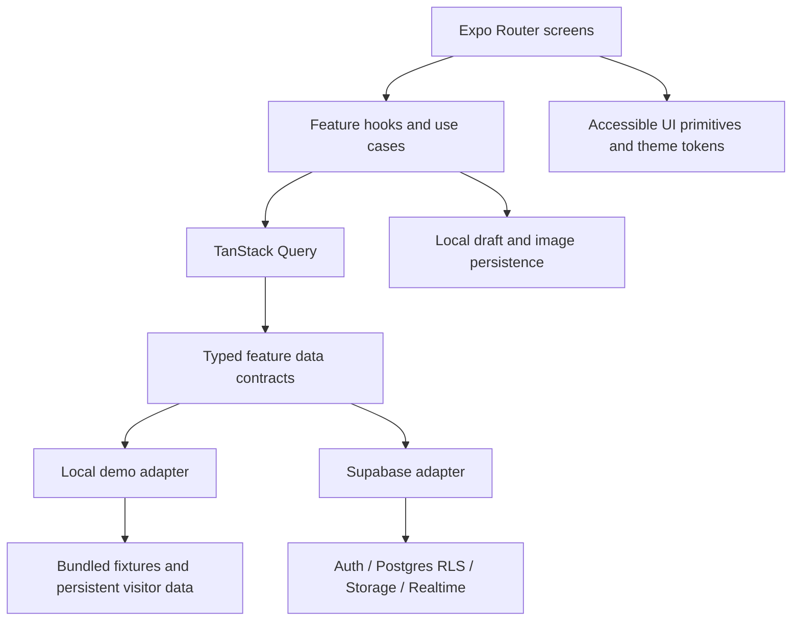

# LocalLoop implementation proposal

Status: build agreement confirmed by the user. Milestone 1 is implemented and browser-verified; see [the verification record](milestone-1.md). Native runtime verification and milestones 2–5 remain outstanding.

## Architecture

- Thin routes under `app/`; feature modules under `src/features/` for explore, listings, saved, sell, auth, profile, messaging, and notifications. Shared UI, localization, and platform services have small dedicated modules.
- Contracts cover listing queries and mutations, saved items, profiles, conversations, messages, and notifications. Auth remains a separate capability; demo does not fake a Supabase session.
- TanStack Query owns fetched data and pagination. Query keys and persisted caches include mode and identity. Mode changes cancel requests, dispose subscriptions, and replace the active cache context.
- Zustand holds small shared preferences such as mode, theme, and language. React Hook Form owns active forms; Zod validates their boundaries. Persistent drafts use a dedicated storage service.
- Demo persistence uses native local storage and browser IndexedDB for uploaded image blobs. Persist durable native image copies rather than picker temporary URIs. Version saved demo data and reset only the demo namespace.
- Cursor pagination uses a stable ID tie-breaker. Search is debounced; changed filters reset pagination. Saved-item mutations cancel stale reads, optimistically patch caches, and roll back on failure.
- Messages retain a client-generated ID across retries. A database uniqueness constraint prevents duplicate persistence, including when a committed send loses its response. Realtime events merge by ID; reconnect refetches reconcile missing events.
- Live writes require server acknowledgement. Cached reads and local drafts remain available offline. Demo mutations are explicitly local operations and simulated messages are labeled.
- Accepted theme: warm ivory surfaces, deep teal action color, restrained terracotta accents, strong price typography, and photography-led cards; charcoal surfaces in dark mode. Bundle licensed photographs and fonts with Bangla coverage. Verify contrast for both themes.
- Mobile uses five bottom tabs; desktop uses the same information architecture with a navigation rail, wider listing grid, and optional split inbox. Support keyboard navigation, dynamic text, reduced motion, and accessible targets from milestone 1.
- English and Bangla cover interface strings, validation, and bundled fixture content. User-generated text remains in its original language; automatic translation is out of scope.
- Select stable Expo and compatible native package versions at implementation time, use Expo's installer for native packages, commit the lockfile, and run compatibility checks. Do not guess future package versions in this plan.
- Web uses Expo `web.output: single`, a static export, and Vercel SPA fallback while preserving assets. This accepts limited per-listing SEO/social previews. No Router server routes.

## Screen map

- Welcome: prominent Explore demo, Live entry, concise product explanation.
- Explore: search, category chips, filter sheet/panel, sort, paginated feed.
- Listing detail: photo gallery, price, description, seller, approximate neighborhood, save/share/message actions.
- Saved: saved listings with empty and failure states.
- Sell: details -> photos -> price and neighborhood -> review; restore/discard draft.
- Inbox: latest messages and unread counts; conversation screen with paginated history and retry controls.
- Profile: profile editing, own listings, theme/language, mode switch, Reset demo, sign out.
- Supporting routes: login, signup, forgot/reset password, edit listing, notifications, unavailable listing, and not found.
- Listing deep links must encode mode. Fixture links work for other visitors; locally created demo listings cannot be shared across devices and need an honest unavailable state.

## Proposed data model

| Entity | Principal fields and constraints |
| --- | --- |
| profiles | auth user ID, display name, avatar object path, neighborhood ID, bio; public fields only |
| neighborhoods | stable ID, English/Bangla names; no seller coordinates |
| categories | stable ID, English/Bangla labels |
| listings | ID, seller ID, title, description, integer BDT price, category, condition, neighborhood, status, creation/update timestamps |
| listing_images | ID, listing ID, owner ID, storage path, dimensions, position |
| saved_listings | user ID + listing ID unique pair |
| conversations | ID, listing ID, buyer ID, seller ID; proposed unique listing/buyer pair |
| messages | stable client-generated UUID, conversation ID, sender ID, body, server timestamp |
| conversation_reads | conversation ID + participant ID; last-read message position for unread counts |
| notifications | ID, recipient ID, event kind, target reference, created/read timestamps; trusted generation |
| local drafts | draft ID, owner/mode namespace, step, validated partial fields, durable image references, schema version |

Deleted listings disappear from discovery and prevent new conversations; existing participants retain read-only message history and a minimal listing-removed reference. Sold and deleted are distinct states. Existing chats remain usable after sale, but sold listings cannot start new conversations. Saved sold listings display Sold; saved removed listings display Unavailable and can be unsaved. Live guests may browse; marketplace writes require approved test accounts, while unapproved signed-in accounts can edit their own profiles. Prices are integer BDT from 0 through 10,000,000 inclusive; zero displays Free. Pending/sent/failed are client delivery states; a stored message is server-acknowledged.

Enforce ownership and participant membership with versioned SQL, grants, RLS, and constrained transactional functions where needed. Conversation creation verifies the listing seller and caller buyer; membership cannot be rewritten by participants. Message sender must equal the authenticated caller. Read cursors belong to their participant. Notifications cannot be forged by arbitrary clients.

Require 1–6 photos per published listing and accept source images up to 10 MB each. Resize and compress before upload, and strip metadata during processing. Published listing photos are publicly readable; draft photos remain local. Storage checks owner paths, listing ownership, approved write access, allowed MIME types, and processed-file size limits. Keep upload completion separate from listing publication, retry per image, and clean abandoned uploads safely. Never put service-role credentials in client code; `.env.example` contains public configuration placeholders only.

## Milestones and verification gates

1. **Design system, navigation, complete local demo.** Bundle realistic fictional data and photography; implement browse/filter/sort/detail/save, durable local sell flow, simulated chat and notifications, own-listing actions, Reset demo, themes, and bilingual UI. Verify a browser visit with no Supabase configuration through browse -> save -> publish locally -> chat -> refresh -> reset. Include deep-link reload and narrow/wide layouts. Add a smoke test now.
2. **Authentication, database, storage, ownership.** Add migrations/seeds, auth restoration and recovery, profile editing, uploads with progress/retry, listing CRUD and RLS. Verify two-user authorization boundaries, anonymous access policy, session expiration, upload denials, and recovery redirects. Test SQL policies against local Supabase rather than mocking authorization.
3. **Realtime messaging and failures.** Add conversation membership, idempotent sends, unread state, history pagination, subscription lifecycle, and notifications. Verify lost acknowledgements, repeated retries, reconnect catch-up, out-of-order events, and unauthorized access.
4. **Offline, native enhancements, accessibility.** Persist eligible read caches; add network status, refresh, haptics, optional location with manual selection, permission fallbacks, safe areas, keyboard handling, and accessibility audit. Verify offline drafts, rollback, large text, screen readers, reduced motion, and browser fallbacks. Native push is conditional on core completion and native build testing.
5. **Release review and portfolio.** Complete CI typecheck/lint/tests/web export, browser smoke coverage, image/bundle performance review, README, screenshots, honest feature matrix, architecture diagram, 60–90 second script, interview topics, and Vercel configuration. Record actual tested environments and remaining limitations. Deployment requires an available deployment account; configuration alone is not a deployment.

Tests for validation, rollback, policies, and duplicate retries arrive with their features; milestone 5 consolidates them. Each implementation milestone ends with changes explained, actual verification results, manual steps, and a review checkpoint.

## Decision tree

Round 1 accepted by the user:
1. Live mode starts as a controlled portfolio sandbox: public browsing, approved test accounts for writes. Public trading is outside the initial release.
2. Deletion preserves existing conversations with a minimal removed-listing reference, removes discovery visibility, and blocks new conversations. Sold is a separate state.
3. Nearby means neighborhood selection, initially browsing all supported Dhaka neighborhoods. Optional location may suggest a neighborhood later; no distance claims.
4. The 60-second acceptance path is enter demo -> find -> save -> receive a labeled simulated reply. Local publishing is the optional next step in the longer walkthrough.
5. Translate interface and bundled fictional content into Bangla. Visitor-created and live content keep their original language.

Round 2 accepted by the user:
1. Signup, login, and own-profile editing remain available to unapproved accounts. Selling and messaging require approval managed outside the client. Explain the restriction and offer Explore demo.
2. Existing chats remain usable after sale and become read-only after listing removal. Neither state permits new conversations. Saved entries show Sold or Unavailable as appropriate and remain removable.
3. Publishing requires 1–6 photos, at most 10 MB per source image, compressed and resized before upload. Published photos are public; drafts stay local. Prices use whole taka, inclusive range 0–10,000,000; zero is Free.
4. One unfinished new-listing draft per mode/account and independent edit drafts per listing. Autosave with restore/discard. Fixture links work across visitors; local demo listings are labeled Only available on this device. Reset removes demo listings, photos, saves, drafts, and chats.
5. Approximately 30 fictional listings across furniture, electronics, books, fashion, sports, and home essentials. Eight Dhaka neighborhoods including Dhanmondi, Mirpur, Uttara, and Mohammadpur. Default newest across all neighborhoods; search both fixture languages. Conditions: Like new, Good, Fair.
6. Notifications cover new messages and saved items marked sold. Suppress active-conversation message alerts. Demo events are labeled Simulated. Native push remains deferred.
7. Ivory/teal/terracotta light theme and charcoal dark theme; photography and prices lead. Desktop navigation rail and listing grid; five mobile tabs.

## Final build agreement (accepted)

- Implement milestone 1 only next. End with actual verification results and reproducible manual steps before moving to milestone 2.
- Routine implementation details such as component names, fixture names, debounce timing, image dimensions, and password-recovery route wiring are engineering decisions within the accepted requirements, not further product interview rounds.
- Use bounded deterministic simulated replies without an external AI service. Include a clearly labeled demo failure control to exercise failed sends and retries without relying on a real network failure.
- Demo identity is one fictional visitor profile. Demo content never migrates into live mode. Theme and language preferences survive Reset demo; demo-generated notifications do not.
- Store no raw coordinates. Optional location suggestion is a later enhancement and must work without a paid geocoding API; manual neighborhood selection is always available.
- Use the browser as the first executed verification target. Report Android/iOS as unverified until actually run on a device or simulator. Inspect available tooling directly rather than asking the user to inventory it.
- Account deletion, moderation tools, and a production retention policy are outside this controlled sandbox release; document these limits before considering public trading.

## References

- Expo web publishing: https://docs.expo.dev/guides/publishing-websites/
- Expo app configuration: https://docs.expo.dev/versions/latest/config/app/
- Supabase React Native auth: https://supabase.com/docs/guides/auth/quickstarts/react-native/
